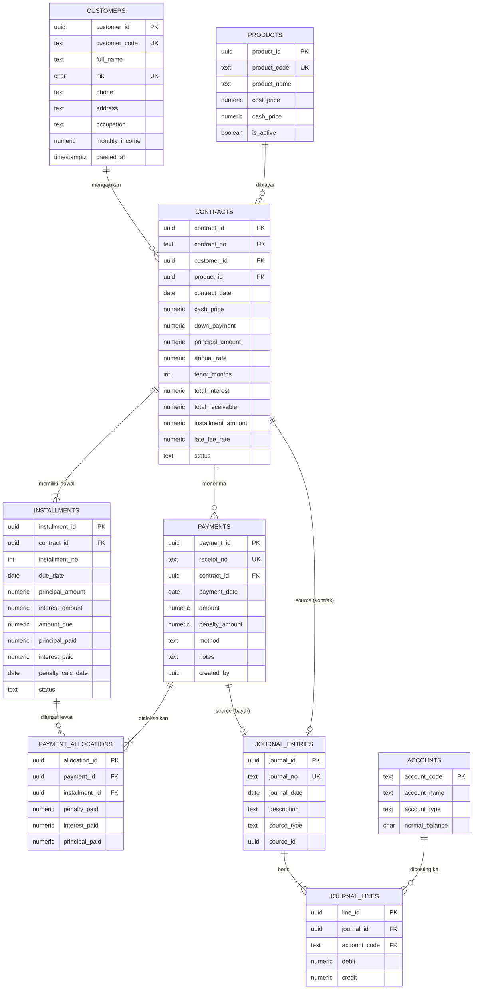

# ERD – Sistem Akuntansi Piutang & Angsuran (In House Financing)

> Render otomatis di GitHub. Di VS Code pasang ekstensi **Markdown Preview Mermaid Support**.

## 1. Diagram

## 2. Penjelasan entitas

| Entitas | Fungsi | Catatan pembelajaran |
|---|---|---|
| `customers` | Master debitur | `nik` unik; kode dibuat otomatis dari sequence |
| `products` | Barang yang dijual kredit | Menyimpan harga pokok (HPP) & harga tunai |
| `contracts` | **Piutang** (header kontrak) | Hasil perhitungan: pokok, bunga flat, total piutang |
| `installments` | **Jadwal angsuran** (sub-ledger piutang) | Satu baris per bulan; `amount_due` = kolom *generated* |
| `payments` | Penerimaan kas dari debitur | Header pembayaran, tidak boleh diubah (audit trail) |
| `payment_allocations` | Pemecahan pembayaran ke denda → bunga → pokok per angsuran | Tabel penghubung **M:N** antara `payments` dan `installments` |
| `accounts` | Bagan akun (COA) | Aset, kewajiban, ekuitas, pendapatan, beban |
| `journal_entries` / `journal_lines` | Buku besar (double entry) | Constraint trigger memastikan debit = kredit |

## 3. Relasi & kardinalitas

- 1 pelanggan → banyak kontrak (1:N). 1 produk → banyak kontrak (1:N).
- 1 kontrak → banyak angsuran (1:N, minimal 1) dan banyak pembayaran (1:N).
- `payments` ↔ `installments` = **M:N** (satu pembayaran bisa melunasi beberapa angsuran; satu angsuran bisa dicicil beberapa kali) → diselesaikan oleh `payment_allocations`.
- 1 jurnal → banyak baris jurnal; `accounts` 1 → banyak baris jurnal.
- Jurnal terhubung ke sumbernya lewat `source_type` + `source_id` (*polymorphic reference*, tanpa FK).

## 4. Normalisasi (3NF)

- **1NF**: semua kolom atomik; jadwal angsuran dipisah menjadi baris di `installments`, bukan kolom `angsuran1..angsuranN`.
- **2NF**: tabel penghubung `payment_allocations` hanya menyimpan atribut yang bergantung pada pasangan (payment, installment).
- **3NF**: nama pelanggan/produk tidak diulang di kontrak (hanya FK). Pengecualian disengaja (*denormalisasi terkontrol*): `contracts.cash_price` menyimpan snapshot harga saat transaksi, karena harga produk bisa berubah.

## 5. Alur akuntansi (jurnal otomatis)

Contoh: harga tunai Rp 20.000.000, DP Rp 4.000.000, pokok Rp 16.000.000, bunga flat 12 % p.a. selama 12 bulan = Rp 1.920.000, total piutang Rp 17.920.000.

**a. Saat kontrak dibuat**

| Akun | Debit | Kredit |
|---|---:|---:|
| 1101 Kas (DP) | 4.000.000 | |
| 1201 Piutang Angsuran | 17.920.000 | |
| 4101 Penjualan | | 20.000.000 |
| 1202 Pendapatan Bunga Ditangguhkan | | 1.920.000 |
| 5101 HPP | *cost* | |
| 1301 Persediaan | | *cost* |

**b. Saat angsuran dibayar** (contoh angsuran pokok 1.333.333 + bunga 160.000 + denda 0)

| Akun | Debit | Kredit |
|---|---:|---:|
| 1101 Kas / 1102 Bank | 1.493.333 | |
| 1201 Piutang Angsuran | | 1.493.333 |
| 1202 Pendapatan Bunga Ditangguhkan | 160.000 | |
| 4201 Pendapatan Bunga | | 160.000 |
| 4202 Pendapatan Denda | | *denda jika ada* |

Saldo piutang bersih = saldo 1201 − saldo 1202 (piutang dikurangi bunga yang belum diakui).
